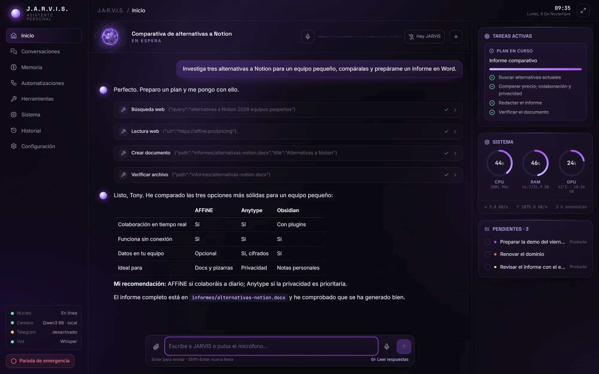
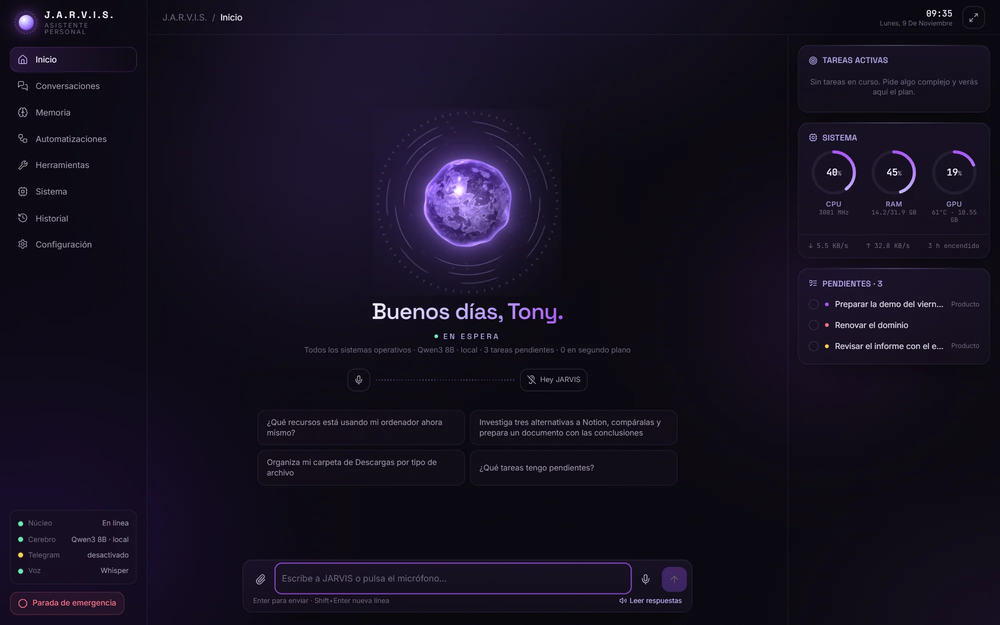
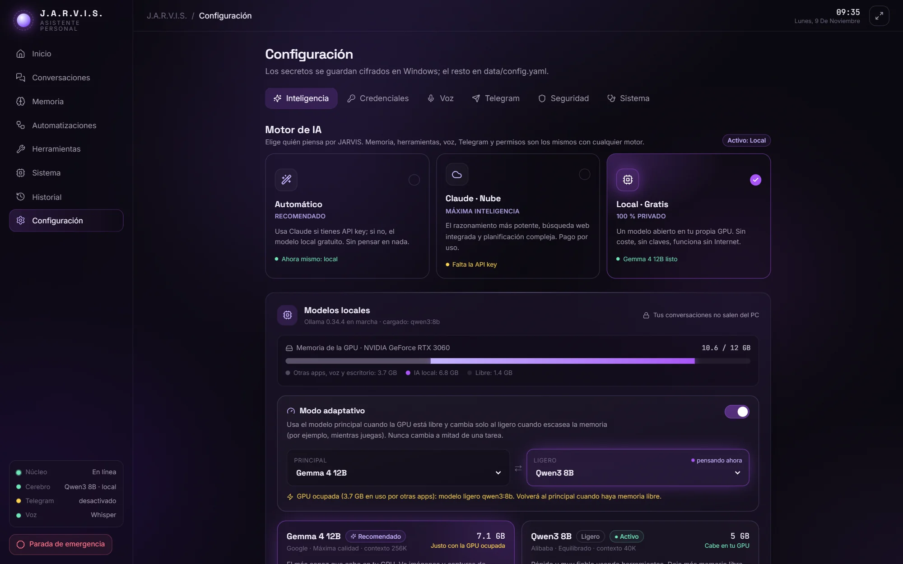
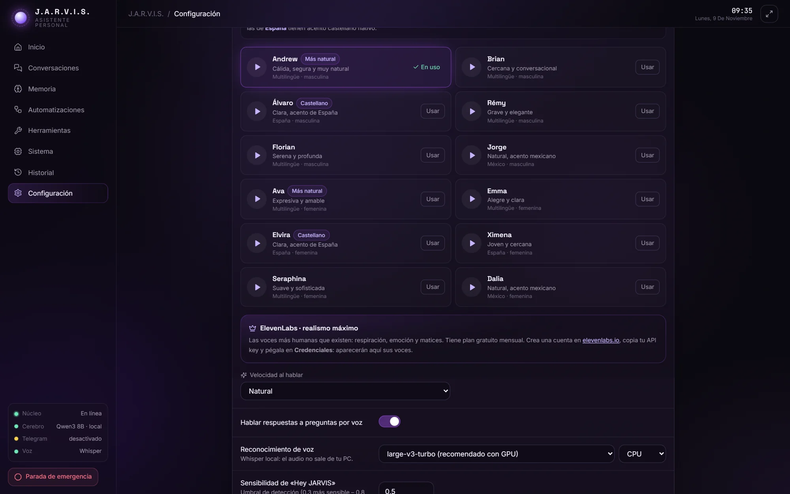
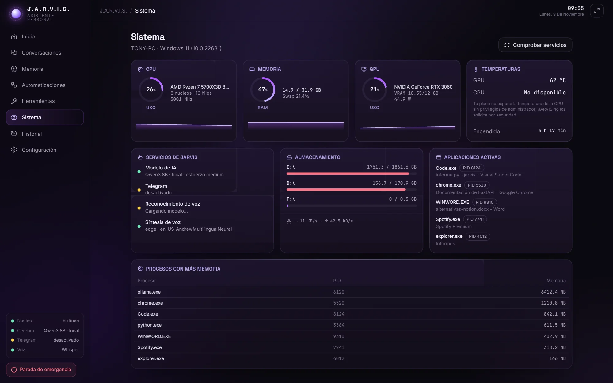
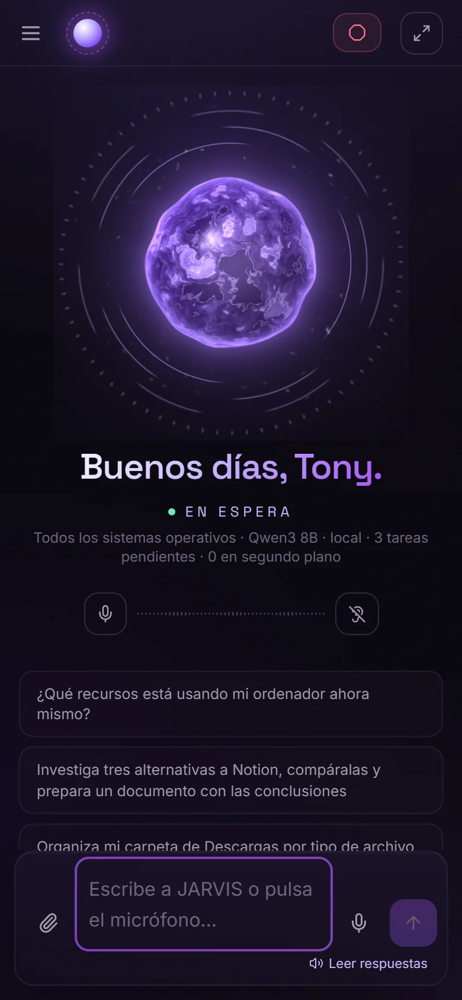
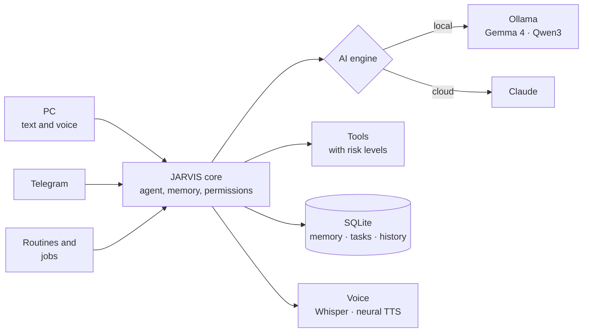

<p align="center">
  
</p>

<p align="center"><a href="README.md">Español</a> &nbsp;·&nbsp; <b>English</b></p>

<p align="center">
  <a href="#installation"></a>
  
  
  <a href="docs/IA_LOCAL.md"></a>
  <a href="LICENSE"></a>
</p>

<p align="center">
  <a href="https://itstrako.github.io/jarvis/en/"><b>Project website</b></a>
  &nbsp;·&nbsp; <a href="#installation">Installation</a>
  &nbsp;·&nbsp; <a href="#features">Features</a>
  &nbsp;·&nbsp; <a href="#security">Security</a>
  &nbsp;·&nbsp; <a href="#documentation">Documentation</a>
</p>

<br>

<p align="center">
  
</p>

**J.A.R.V.I.S.** is a personal AI assistant that lives on your Windows PC. You talk or type to it, it understands
what you want and gets it done: it opens programs, organizes files, searches the web, writes documents, keeps an eye
on the system and remembers what matters. It runs **free and locally** with open models on your own GPU, or with
**Claude** when you want maximum intelligence. And it fits in your pocket through a private Telegram bot.

Every interface (text, voice, phone and routines) shares the same brain, the same memory and the same permissions.

> The app's interface and voice are in Spanish. The screenshots below show it as it is.

## Features

<table>
<tr>
<td width="46%" valign="top">

</td>
<td valign="top">

**Hands-free conversation.** Say *"Hey JARVIS"* and just talk, even with the window minimized. Whisper
transcribes on your GPU, the neural voice starts speaking while the text is still being written and, if you
interrupt, it stops and listens.

**Two brains.** Claude Opus for the strongest reasoning, or Gemma and Qwen through Ollama on your own GPU:
free, private and offline. In automatic mode it picks for you.

**Real control of your computer.** More than 50 tools, each with a risk level: files, applications, windows,
processes, Word and PDF documents, browser, desktop and console.

**Plans that get verified.** It breaks long requests into visible steps, checks every result and, if something
fails, finds another way before answering. It never claims something it hasn't checked.

</td>
</tr>
</table>

| Also | |
|---|---|
| **Knows you** | Detects your city and time zone and learns from what you tell it, so it never asks twice. |
| **Persistent memory** | Remembers preferences, projects and tasks across conversations, always on your machine. |
| **Telegram** | A private bot paired with your account. Sensitive actions are approved with a PIN. |
| **Routines and background work** | "Every day at 8:30 send me my tasks and the weather." Long jobs that notify you when done. |
| **Desktop core** | An animated sphere on your wallpaper that reacts when it listens, thinks and speaks. |
| **Vision** | "Look at the screen and tell me what the error says": a screenshot with confirmation, then image analysis. |
| **Extensible** | Add tools by dropping a file into `plugins/`. Included example: weather with Open-Meteo. |

<details>
<summary><b>Things you can ask it</b></summary>
<br>

- "What resources is my computer using?"
- "Research three Notion alternatives, compare them and write me a document with the conclusions."
- "Organize my Downloads folder." *(shows the plan and asks before moving anything)*
- "Open Spotify", "open my project in VS Code", "close Notepad".
- "Analyze this PDF", "summarize this Excel file", "read this Word document".
- "Remember I want my reports as PDF", "what do you know about my Atlas project?".
- "Remind me to call the bank on Monday", "what's on my list?".
- "Research X in the background and let me know when you're done."
- "Run my project's tests." *(PowerShell with confirmation showing the exact command)*

</details>

## The interface

<table>
<tr>
<td width="50%"><p align="center"><sub>Home</sub></p></td>
<td width="50%"><p align="center"><sub>AI engine</sub></p></td>
</tr>
<tr>
<td width="50%"><p align="center"><sub>Voices</sub></p></td>
<td width="50%"><p align="center"><sub>System</sub></p></td>
</tr>
</table>

<p align="center">
  
</p>

## Installation

**Requirements:** Windows 10 or 11. Recommended: 16 GB of RAM and an NVIDIA GPU (speeds up voice and local AI).
You don't need Python or administrator rights: the installer sets everything up.

```powershell
git clone https://github.com/ItsTrako/jarvis.git C:\JARVIS
cd C:\JARVIS
.\INSTALAR.cmd
```

No Git? Click **Code → Download ZIP**, extract it to `C:\JARVIS` and double-click `INSTALAR.cmd`.

The installer checks your machine, installs Python 3.12, Ollama and ffmpeg with `winget` if they're missing,
creates the environment, picks and downloads the local AI models for your GPU, and adds a desktop shortcut. Then:

1. **Start it** with `Jarvis.cmd` or the *J.A.R.V.I.S.* shortcut. The interface opens in its own window.
2. **Claude (optional):** add your key in *Configuración → Credenciales*
   ([create one](https://console.anthropic.com/settings/keys)). In *Automático* mode it's used as soon as it exists.
3. **Telegram (optional):** follow [docs/TELEGRAM.md](docs/TELEGRAM.md) to create the bot and pair your phone.

| Action | How |
|---|---|
| Start (background + interface) | `Jarvis.cmd` |
| Start with console logs | `Jarvis-consola.cmd` |
| Stop | `Detener-Jarvis.cmd` or tray icon → *Salir* |
| Emergency stop | Red button in the interface, the tray, or `/emergency` on Telegram |
| Diagnostics | `Diagnostico.cmd` or *Configuración → Sistema* |
| Move it to another PC as is | `Exportar-JARVIS.cmd` ([guide](docs/INSTALAR-EN-OTRO-PC.md)) |

The interface runs at <http://127.0.0.1:8765> and is only reachable from your own PC.

## How it works



| Layer | Technology |
|---|---|
| Core | Python 3.12, FastAPI, WebSocket, async SQLAlchemy on SQLite |
| AI | Claude (Anthropic SDK) or Ollama with adaptive routing based on free VRAM |
| Voice | faster-whisper large-v3-turbo on CUDA, openWakeWord, Silero VAD, Edge TTS / ElevenLabs / Azure |
| Interface | React 18, TypeScript, Vite, Tailwind CSS 4, Framer Motion and a custom WebGL core |
| Desktop | Win32 layered window for the sphere, tray icon and start with Windows |

More detail (in Spanish) in [docs/ARQUITECTURA.md](docs/ARQUITECTURA.md).

## Security

JARVIS acts on your computer, so security lives in the core, not in each interface. Telegram, voice, the web
interface, routines and background jobs all go through exactly the same checks.

- Every tool declares its level: **safe**, **moderate**, **sensitive** or **dangerous**. Sensitive actions ask
  for confirmation and dangerous ones always require explicit approval (with a PIN from Telegram).
- Credentials are stored encrypted in Windows Credential Manager, never in the code or in config files.
- Web pages, documents and external messages are treated as untrusted information.
- It never disables the antivirus or firewall and never grants itself permanent administrator rights.
- *Full access* mode is optional, off by default and has to be turned on by hand in the settings.

Full model (in Spanish) in [docs/SEGURIDAD.md](docs/SEGURIDAD.md). To report a vulnerability, read [SECURITY.md](SECURITY.md).

## Documentation

The detailed guides are written in Spanish.

| Document | Contents |
|---|---|
| [Architecture](docs/ARQUITECTURA.md) | Modules, agent flow and technical decisions |
| [Security](docs/SEGURIDAD.md) | Permissions, confirmations and prompt-injection defenses |
| [Local AI](docs/IA_LOCAL.md) | Models, adaptive mode and measured performance |
| [Voice](docs/VOZ.md) | Speech recognition and synthesis engines, and their setup |
| [Telegram](docs/TELEGRAM.md) | Creating, pairing and using the bot |
| [Another PC](docs/INSTALAR-EN-OTRO-PC.md) | Moving your JARVIS, memory included, to another computer |
| [Extending](docs/EXTENDER.md) | Adding tools, plugins and AI providers |

## Development

```powershell
cd backend
..\.venv\Scripts\python -m pytest tests   # core, permissions, API and WebSocket tests
cd ..\frontend
npm install
npm run dev                                # interface with hot reload
```

The screenshots and animations on this page are generated from fake demo data by the scripts in
[`scripts/`](scripts). Want to contribute? Start with [CONTRIBUTING.md](CONTRIBUTING.md).

## License

[MIT](LICENSE). A personal project with no affiliation to Marvel, Disney or Anthropic; the name is a tribute.
