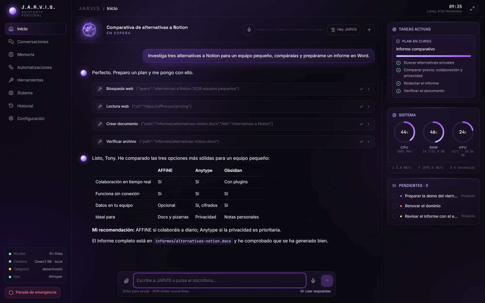
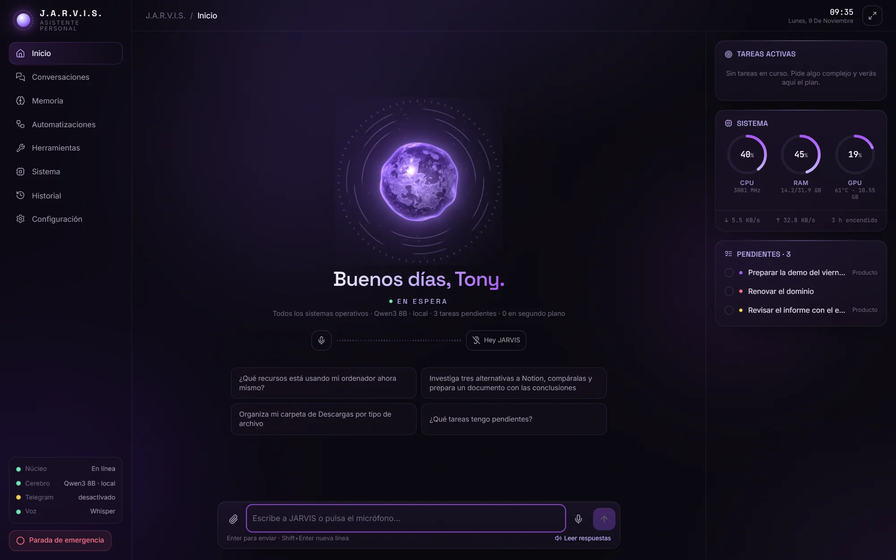
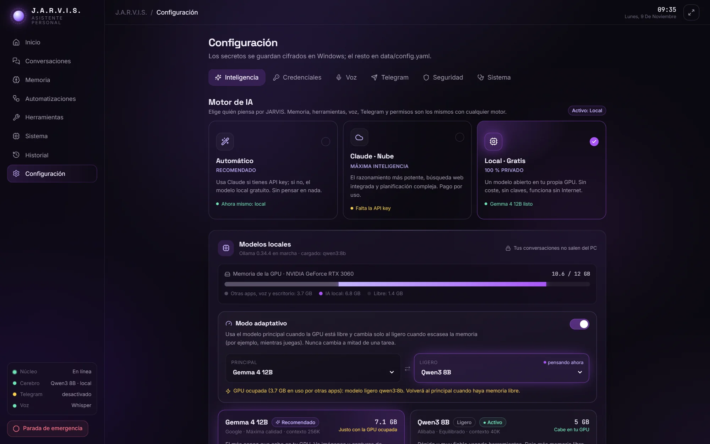
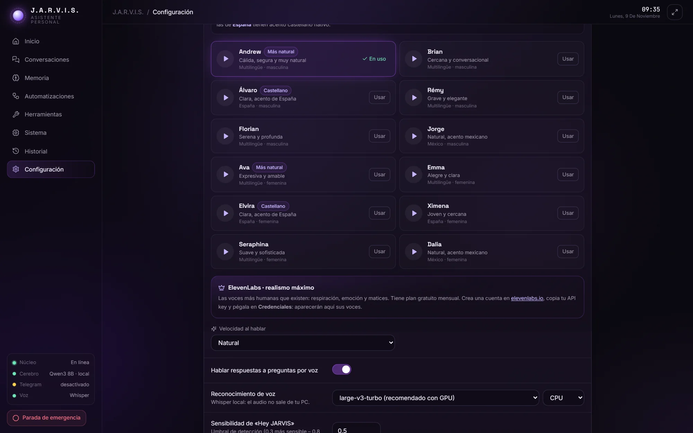
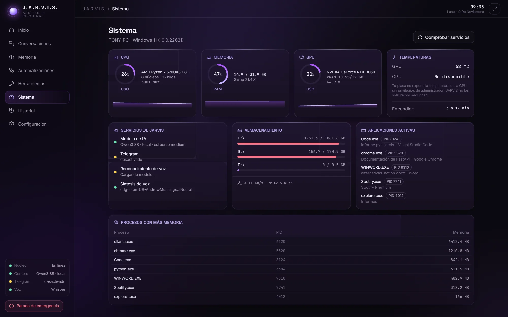
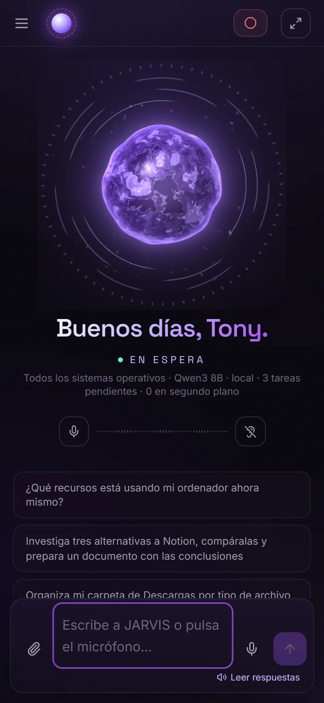
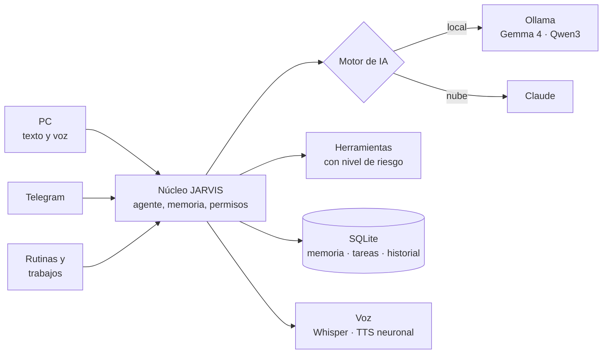

<p align="center">
  
</p>

<p align="center"><b>Español</b> &nbsp;·&nbsp; <a href="README.en.md">English</a></p>

<p align="center">
  <a href="#instalación"></a>
  
  
  <a href="docs/IA_LOCAL.md"></a>
  <a href="LICENSE"></a>
</p>

<p align="center">
  <a href="https://itstrako.github.io/jarvis/"><b>Web del proyecto</b></a>
  &nbsp;·&nbsp; <a href="#instalación">Instalación</a>
  &nbsp;·&nbsp; <a href="#capacidades">Capacidades</a>
  &nbsp;·&nbsp; <a href="docs/SEGURIDAD.md">Seguridad</a>
  &nbsp;·&nbsp; <a href="#documentación">Documentación</a>
</p>

<br>

<p align="center">
  
</p>

**J.A.R.V.I.S.** es un asistente personal de IA que vive en tu PC con Windows. Le hablas o le escribes, entiende
lo que quieres y lo hace: abre programas, organiza archivos, busca en internet, redacta documentos, vigila el
sistema y recuerda lo importante. Funciona **gratis y en local** con modelos abiertos en tu GPU, o con
**Claude** cuando quieres la máxima inteligencia. Y lo llevas en el bolsillo gracias a un bot privado de Telegram.

Todas las interfaces (texto, voz, móvil y rutinas) comparten el mismo cerebro, la misma memoria y los mismos permisos.

## Capacidades

<table>
<tr>
<td width="46%" valign="top">

</td>
<td valign="top">

**Conversación manos libres.** Di *«Hey JARVIS»* y habla con normalidad, aunque la ventana esté minimizada.
Whisper transcribe en tu GPU, la voz neuronal empieza a sonar mientras el texto aún se escribe y, si le
interrumpes, se calla y te escucha.

**Dos cerebros.** Claude Opus para el razonamiento más potente, o Gemma y Qwen con Ollama en tu propia GPU:
gratis, privado y sin conexión. En modo automático elige solo.

**Control real del ordenador.** Más de 50 herramientas con nivel de riesgo: archivos, aplicaciones,
ventanas, procesos, documentos Word y PDF, navegador, escritorio y consola.

**Planes que se comprueban.** Divide los encargos largos en pasos visibles, verifica cada resultado y, si
algo falla, busca otra vía antes de responder. Nunca da por hecho lo que no ha comprobado.

</td>
</tr>
</table>

| Además | |
|---|---|
| **Te conoce** | Detecta tu ciudad y tu zona horaria y aprende de lo que le cuentas, para no preguntarte dos veces. |
| **Memoria persistente** | Recuerda preferencias, proyectos y tareas entre conversaciones, siempre en tu equipo. |
| **Telegram** | Bot privado emparejado con tu cuenta. Las acciones delicadas se aprueban con PIN. |
| **Rutinas y segundo plano** | «Cada día a las 8:30 envíame mis tareas y el tiempo». Trabajos largos que te avisan al terminar. |
| **Núcleo en el escritorio** | Una esfera animada sobre el fondo de pantalla que reacciona al escuchar, pensar y hablar. |
| **Visión** | «Mira la pantalla y dime qué error sale»: captura con confirmación y análisis de la imagen. |
| **Extensible** | Añade herramientas soltando un archivo en `plugins/`. Ejemplo incluido: el tiempo con Open-Meteo. |

<details>
<summary><b>Ejemplos de lo que puedes pedirle</b></summary>
<br>

- «¿Qué recursos está usando mi ordenador?»
- «Investiga tres alternativas a Notion, compáralas y prepárame un documento con las conclusiones.»
- «Organiza mi carpeta de Descargas.» *(muestra el plan y pide confirmación antes de mover nada)*
- «Abre Spotify», «abre mi proyecto en VS Code», «cierra el Bloc de notas».
- «Analiza este PDF», «resume este Excel», «lee este documento de Word».
- «Recuerda que mis informes los quiero en PDF», «¿qué sabes de mi proyecto Atlas?».
- «Apunta llamar al banco el lunes», «¿qué tengo pendiente?».
- «Investiga X en segundo plano y avísame cuando acabe.»
- «Ejecuta los tests de mi proyecto.» *(PowerShell con confirmación mostrando el comando exacto)*

</details>

## La interfaz

<table>
<tr>
<td width="50%"><p align="center"><sub>Inicio</sub></p></td>
<td width="50%"><p align="center"><sub>Motor de IA</sub></p></td>
</tr>
<tr>
<td width="50%"><p align="center"><sub>Voces</sub></p></td>
<td width="50%"><p align="center"><sub>Sistema</sub></p></td>
</tr>
</table>

<p align="center">
  
</p>

## Instalación

**Requisitos:** Windows 10 u 11. Recomendado: 16 GB de RAM y una GPU NVIDIA (acelera la voz y la IA local).
No hace falta tener Python ni permisos de administrador: el instalador lo prepara todo.

```powershell
git clone https://github.com/ItsTrako/jarvis.git C:\JARVIS
cd C:\JARVIS
.\INSTALAR.cmd
```

¿Sin Git? Pulsa **Code → Download ZIP**, descomprímelo en `C:\JARVIS` y haz doble clic en `INSTALAR.cmd`.

El instalador comprueba el equipo, instala Python 3.12, Ollama y ffmpeg con `winget` si faltan, crea el entorno,
elige y descarga los modelos de IA local según tu GPU, y crea el acceso directo del escritorio. Después:

1. **Arranca** con `Jarvis.cmd` o el acceso directo *J.A.R.V.I.S.* La interfaz se abre en su propia ventana.
2. **Claude (opcional):** añade tu clave en *Configuración → Credenciales*
   ([crear una](https://console.anthropic.com/settings/keys)). En modo *Automático* la usará en cuanto exista.
3. **Telegram (opcional):** sigue [docs/TELEGRAM.md](docs/TELEGRAM.md) para crear el bot y emparejar tu móvil.

| Acción | Cómo |
|---|---|
| Iniciar (segundo plano + interfaz) | `Jarvis.cmd` |
| Iniciar con registros en consola | `Jarvis-consola.cmd` |
| Detener | `Detener-Jarvis.cmd` o icono de la bandeja → *Salir* |
| Parada de emergencia | Botón rojo de la interfaz, la bandeja o `/emergency` en Telegram |
| Diagnóstico | `Diagnostico.cmd` o *Configuración → Sistema* |
| Llevarlo igual a otro PC | `Exportar-JARVIS.cmd` ([guía](docs/INSTALAR-EN-OTRO-PC.md)) |

La interfaz vive en <http://127.0.0.1:8765> y solo es accesible desde tu propio PC.

## Cómo funciona



| Capa | Tecnología |
|---|---|
| Núcleo | Python 3.12, FastAPI, WebSocket, SQLAlchemy asíncrono sobre SQLite |
| IA | Claude (SDK de Anthropic) u Ollama con enrutado adaptativo según la VRAM libre |
| Voz | faster-whisper large-v3-turbo en CUDA, openWakeWord, Silero VAD, Edge TTS / ElevenLabs / Azure |
| Interfaz | React 18, TypeScript, Vite, Tailwind CSS 4, Framer Motion y un núcleo WebGL propio |
| Escritorio | Ventana superpuesta Win32 para la esfera, icono de bandeja e inicio con Windows |

Más detalle en [docs/ARQUITECTURA.md](docs/ARQUITECTURA.md).

## Seguridad

JARVIS actúa sobre tu ordenador, así que la seguridad está en el núcleo y no en cada interfaz. Telegram, la voz,
la web, las rutinas y los trabajos en segundo plano pasan exactamente por las mismas comprobaciones.

- Cada herramienta declara su nivel: **seguro**, **moderado**, **sensible** o **peligroso**. Lo sensible pide
  confirmación y lo peligroso exige confirmación explícita siempre (con PIN desde Telegram).
- Las credenciales se guardan cifradas en el Administrador de credenciales de Windows, nunca en el código ni en archivos de configuración.
- Páginas web, documentos y mensajes externos se tratan como información no confiable.
- Nunca desactiva el antivirus ni el firewall y no se concede privilegios de administrador permanentes.
- El modo de *acceso total* es opcional, está desactivado por defecto y se activa a mano desde la configuración.

Modelo completo en [docs/SEGURIDAD.md](docs/SEGURIDAD.md). Para informar de una vulnerabilidad, lee [SECURITY.md](SECURITY.md).

## Documentación

| Documento | Contenido |
|---|---|
| [Arquitectura](docs/ARQUITECTURA.md) | Módulos, flujo del agente y decisiones técnicas |
| [Seguridad](docs/SEGURIDAD.md) | Permisos, confirmaciones y defensa frente a inyección de instrucciones |
| [IA local](docs/IA_LOCAL.md) | Modelos, modo adaptativo y rendimiento medido |
| [Voz](docs/VOZ.md) | Motores de reconocimiento y síntesis, y su configuración |
| [Telegram](docs/TELEGRAM.md) | Crear el bot, emparejarlo y usarlo |
| [Otro PC](docs/INSTALAR-EN-OTRO-PC.md) | Llevar tu JARVIS, con su memoria, a otro ordenador |
| [Extender](docs/EXTENDER.md) | Añadir herramientas, plugins y proveedores de IA |

## Desarrollo

```powershell
cd backend
..\.venv\Scripts\python -m pytest tests   # pruebas del núcleo, permisos, API y WebSocket
cd ..\frontend
npm install
npm run dev                                # interfaz con recarga en caliente
```

Las capturas y animaciones de esta página se generan con datos ficticios mediante los scripts de
[`scripts/`](scripts). Si quieres colaborar, empieza por [CONTRIBUTING.md](CONTRIBUTING.md).

## Licencia

[MIT](LICENSE). Proyecto personal sin relación con Marvel, Disney ni Anthropic; el nombre es un homenaje.
